# 🎓 Student Performance Tracking & Prediction System
### An End-to-End Machine Learning System for Academic Analytics, Predictive Tracking & Intervention Planning


-brightgreen.svg)

---

## 📖 Table of Contents
1. [Project Overview](#-project-overview)
2. [Key Features](#-key-features)
3. [Dashboard Architecture & Tabs](#-dashboard-architecture--tabs)
4. [Machine Learning Pipeline](#-machine-learning-pipeline)
5. [Dataset Schema](#-dataset-schema)
6. [Project File Structure](#-project-file-structure)
7. [Installation & Setup](#-installation--setup)
8. [Running the Application](#-running-the-application)
9. [Running Tests](#-running-tests)
10. [License & Acknowledgements](#-license--acknowledgements)

---

## 🌟 Project Overview

The **Student Performance Tracking & Prediction System** is an AI-powered educational intelligence platform designed for teachers, academic advisors, school administrators, and students.

The system analyzes behavioral, attendance, and historical performance data to:
- **Forecast Student Outcomes** into 3 actionable academic tiers (*Good*, *Average*, *Needs Improvement*).
- **Diagnose At-Risk Factors** before final examinations occur.
- **Simulate "What-If" Interventions** using real-time interactive parameters.
- **Auto-Calculate Optimal Roadmaps** with an AI Target Goal Optimizer.
- **Manage Student Records** with live updates directly synced to the dataset.

---

## 🚀 Key Features

- **🎯 Individual Report Cards & Diagnostics:** Compare any student’s metrics against cohort benchmarks with automated strength and growth area detection.
- **🔮 Interactive "What-If" Simulator:** Adjust weekly study hours, attendance rates, extracurriculars, and parental support to test future scenarios in real time.
- **🎯 AI Target Goal Optimizer:** Calculates the exact minimum study hours and attendance needed for a student to reach the **"Good"** performance tier.
- **💾 Live Dataset Sync & Commits:** Save simulated improvements or direct edits straight to `student_performance.csv` with instant cache reloads.
- **👤 Real-Time Profile Predictor:** Input custom details for new or prospective students to generate instant predictions and mentor action plans.
- **📁 Dataset Explorer & Record Management:** Search across 1,000+ records, apply multi-tier filters, edit existing student profiles, add new students, and export filtered datasets to CSV.
- **📊 Academic Analytics & Insights:** Visual distributions of performance tiers and machine learning feature importance rankings.

---

## 🧭 Dashboard Architecture & Tabs

The web application is built with **Streamlit** and organized into four core modules:

```mermaid
graph TD
    A[Student Performance Dashboard] --> B[Tab 1: 🎯 Student Tracking & Simulator]
    A --> C[Tab 2: 👤 Real-Time Predictor]
    A --> D[Tab 3: 📁 Dataset Explorer & Editor]
    A --> E[Tab 4: 📊 Academic Analytics]

    B --> B1[Historical Metrics vs Class Benchmark]
    B --> B2[AI Diagnostic & Mentor Action Plan]
    B --> B3[What-If Simulator with Sliders]
    B --> B4[AI Goal Optimizer Path to Good]
    B --> B5[Save & Commit to CSV]

    C --> C1[Custom Student Input Form]
    C --> C2[Real-Time Tier & Probability Breakdown]
    C --> C3[Actionable Recommendations]

    D --> D1[Search by Name or Student ID]
    D --> D2[Multi-Category Filter Good/Avg/At-Risk]
    D --> D3[Inline Student Record Editor]
    D --> D4[Add New Student to Database]
    D --> D5[Export Filtered Data to CSV]

    E --> E1[Cohort Grade Tier Distribution]
    E --> E2[Random Forest Feature Importance]
```



---

## 🧠 Machine Learning Pipeline

### 1. Data Cleaning & Preprocessing
- **Missing Value Imputation:** Numerical fields imputed with cohort medians; categorical fields filled with robust defaults.
- **Anomaly Handling:** Negative study hours capped at $\ge 0.0$; attendance capped at $\le 100\%$.
- **Categorical Encoding:** `Gender` (Male: 1, Female: 0), `ParentalSupport` (Low: 0, Medium: 1, High: 2), `Online Classes Taken` (Boolean to Integer).

### 2. Performance Classification Tiers
| Academic Tier | Final Exam Score | Description & Action |
| :---: | :---: | :--- |
| 🟢 **Good Performance** | **$\ge 85$** | Honors / top standing. Eligible for peer tutoring & leadership. |
| 🟡 **Average Performance** | **$70 - 84$** | Meeting curriculum standards. Adding 3–4 hrs/wk study targets honors. |
| 🔴 **Needs Improvement** | **$< 70$** | At-risk. Immediate intervention & structured schedules recommended. |

### 3. Evaluated Models
- **Logistic Regression** (Standardized baseline model)
- **Decision Tree Classifier** (Interpretable tree-based classifier)
- **Random Forest Classifier** (**Champion Model** — 100 ensemble estimators, robust against overfitting)

---

## 📊 Dataset Schema (`student_performance.csv`)

| Column Name | Data Type | Description |
| :--- | :---: | :--- |
| `StudentID` | `float/int` | Unique student identification number. |
| `Name` | `string` | Full name of the student. |
| `Gender` | `string` | Student gender (`Male` / `Female`). |
| `AttendanceRate` | `float` | Main semester attendance rate (50.0% – 100.0%). |
| `StudyHoursPerWeek`| `float` | Dedicated weekly study time (1.0 – 40.0 hrs). |
| `PreviousGrade` | `float` | Academic score from preceding term (50.0 – 100.0). |
| `ExtracurricularActivities` | `int` | Number of active clubs/sports/societies (0 to 3+). |
| `ParentalSupport` | `string` | Home academic support level (`Low`, `Medium`, `High`). |
| `FinalGrade` | `float` | Final exam score (Target score for tier categorization). |
| `Study Hours` | `float` | Average daily study hours (0.0 – 8.0 hrs). |
| `Attendance (%)` | `float` | Normalized overall attendance check percentage. |
| `Online Classes Taken` | `bool` | Whether the student attended digital coursework (`True`/`False`). |

---

## 📂 Project File Structure

```text
student_performance/
│
├── app.py                                    # Interactive Streamlit Web Application
├── student_performance.csv                   # Master Student Dataset (1,000 records)
├── student_performance_tracking_system.ipynb  # Complete Jupyter Notebook Workflow
├── generate_notebook.py                      # Automated Notebook Generation Script
├── run_full_test_suite.py                    # End-to-End System Test Suite (6 Tests)
├── test_nb.py                                # Jupyter Notebook Execution Verifier
└── README.md                                 # Project Documentation & User Guide
```

---

## 🛠️ Installation & Setup

### 1. Prerequisites
Ensure you have **Python 3.8+** installed on your system.

### 2. Install Required Dependencies
Install the required Python packages via pip:

```bash
pip install streamlit pandas numpy matplotlib seaborn scikit-learn
```

---

## 🖥️ Running the Application

Launch the Streamlit interactive dashboard:

```bash
streamlit run app.py
```

Once started, the application will open automatically in your browser at:
`http://localhost:8501`

---

## 🧪 Running Tests

The project includes an end-to-end automated test suite that validates the dataset integrity, cleaning pipeline, machine learning models, prediction edge cases, and Jupyter notebook cells.

Execute the test suite:
```bash
python run_full_test_suite.py
```

### Expected Output:
```text
================================================================
     STUDENT PERFORMANCE TRACKING SYSTEM - FULL TEST SUITE      
================================================================
 [TEST 1] Verifying Dataset (1,000 rows, 12 columns)       -> [OK] PASS
 [TEST 2] Preprocessing & Anomaly Capping (0 nulls)        -> [OK] PASS
 [TEST 3] ML Models (Logistic Reg, Decision Tree, RF)      -> [OK] PASS
 [TEST 4] Prediction Function on Boundary Test Cases       -> [OK] PASS
 [TEST 5] Jupyter Notebook Execution (17 code cells)       -> [OK] PASS
 [TEST 6] Feature Importance Verification                  -> [OK] PASS
================================================================
  >>> ALL TESTS PASSED SUCCESSFULLY! PROJECT IS 100% READY <<<  
================================================================
```

---

## 📄 License & Acknowledgements

Developed for academic research, educational tracking, and machine learning demonstrations. Built using open-source tools: [Streamlit](https://streamlit.io/), [Scikit-Learn](https://scikit-learn.org/), [Pandas](https://pandas.pydata.org/), and [Seaborn](https://seaborn.pydata.org/).
